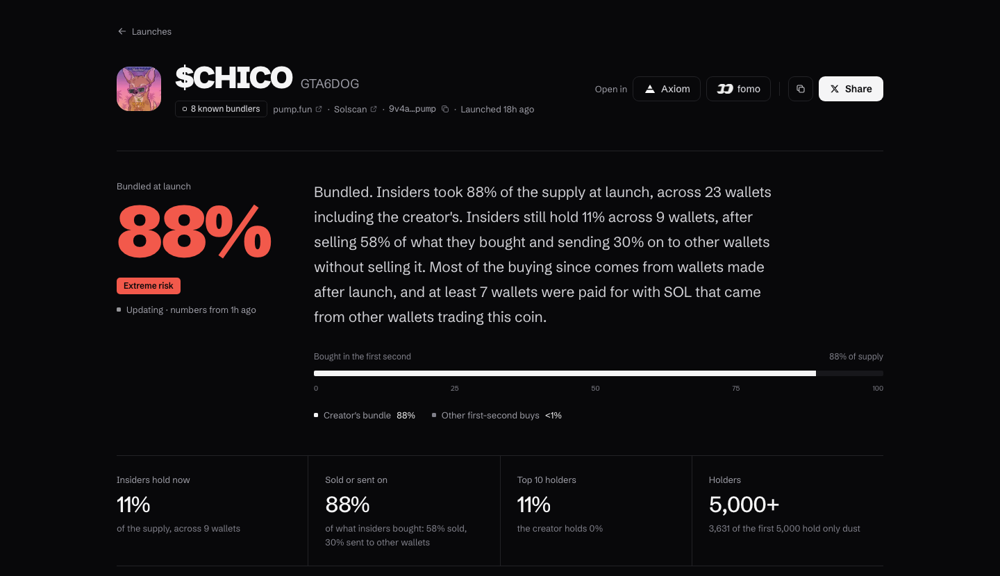
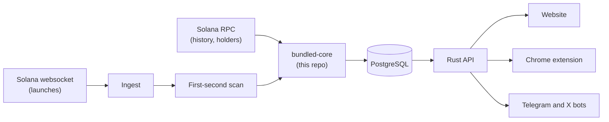
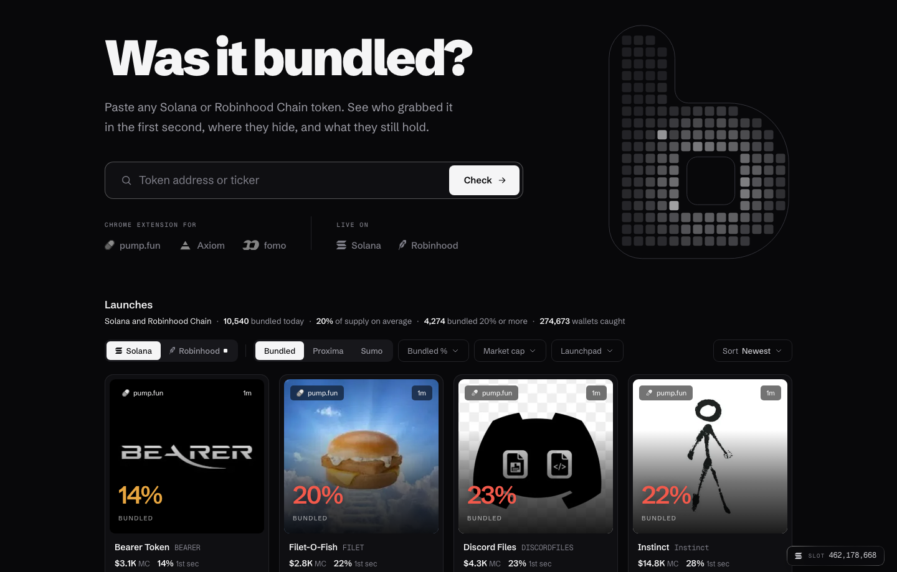
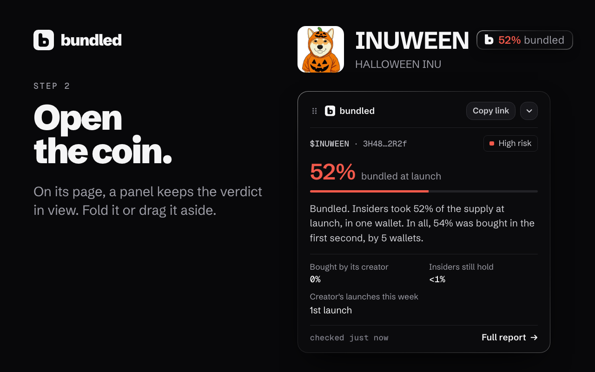

# Bundled

Bundled told Solana traders, seconds after a token launched, whether its creator had quietly bought up the supply with wallets of their own.

I built it on my own and ran it in production in October 2026. In that time it read **737,000+ token launches** as they happened and caught **275,000 wallets** buying in coordinated launches, before I shut it down.

This repo holds the part that does the actual detection: the Rust crate that turns raw Solana transactions into a verdict. The rest of the system (the API, the website, the browser extension and the bots) stays private.



## The problem

On a Solana launchpad anyone can create a token in a few seconds. A common trick: the creator launches it and, in the same instant, buys most of the supply through dozens of fresh wallets so it looks like real demand. Then they sell into the people who follow. On-chain it's all public, but nobody can read it by hand in the seconds that matter.

## How a launch is read

1. **Stream.** A websocket subscription delivers every create transaction from the launchpads as it lands.
2. **First second.** Every buy in the launch's first block is read and grouped: buys in the same transaction as the create, wallets sent together in one Jito bundle, several wallets bought in one transaction, and wallets the creator paid for. Each token is counted once, even when it changes hands inside that second.
3. **Follow the money.** For each insider wallet, the SOL it held before the launch is traced back to where it came from, separating exchange withdrawals from wallets funded by the creator or by each other.
4. **What happened next.** Who still holds, who sold, who sent tokens on to new wallets, how much supply was burned, and whether the coin crashed and who sold into it.
5. **Verdict.** All of it becomes a short, plain-English verdict and a risk level, with every number traceable to the transactions behind it. Supply always adds up to 100%.



## What's in here

`core/` is pure logic: no network and no database. Callers fetch the transactions; this crate decides what they mean.

| Module | What it does |
|---|---|
| `tx` | Reads the parts of a Solana transaction the detection needs |
| `pump`, `launchlab`, `dbc` | Recognize launches and decode events on pump.fun, Raydium LaunchLab and Meteora |
| `bundle` | Who bought at launch, and how much |
| `funding` | Where insiders got their SOL before the launch |
| `analysis` | The full report: what every flagged wallet did, who holds now, red flags and the risk level |
| `trades` | Curve trades and the market-cap chart built from them |
| `crash` | Coins that lost most of their value within minutes, and who sold into the drop |
| `pnl` | A wallet's realized profit and loss on a coin |
| `streamflow` | Reads token locks, so locked supply isn't mistaken for someone holding it |
| `labels` | Known exchange and service addresses |
| `b58` | A faster base58 decoder: the standard one was most of a report's CPU time |

## Tested against real launches

Every rule is tested on real mainnet transactions saved in `fixtures/`: launches that were bundled, launches that only looked bundled, and the edge cases that once produced a wrong report. When a report came out wrong in production, the fix came with a test built from that exact launch.

```sh
cargo test --release
```

100 tests, all from real on-chain data.

## The rest of the product





- **Backend:** Rust (Tokio, Axum, SQLx), PostgreSQL
- **Website:** Next.js, React, TypeScript
- **Also:** a Chrome extension that showed the verdict on trading sites, and Telegram and X bots
- **Infrastructure:** Fly.io, Cloudflare, GitHub Actions

## License

MIT
